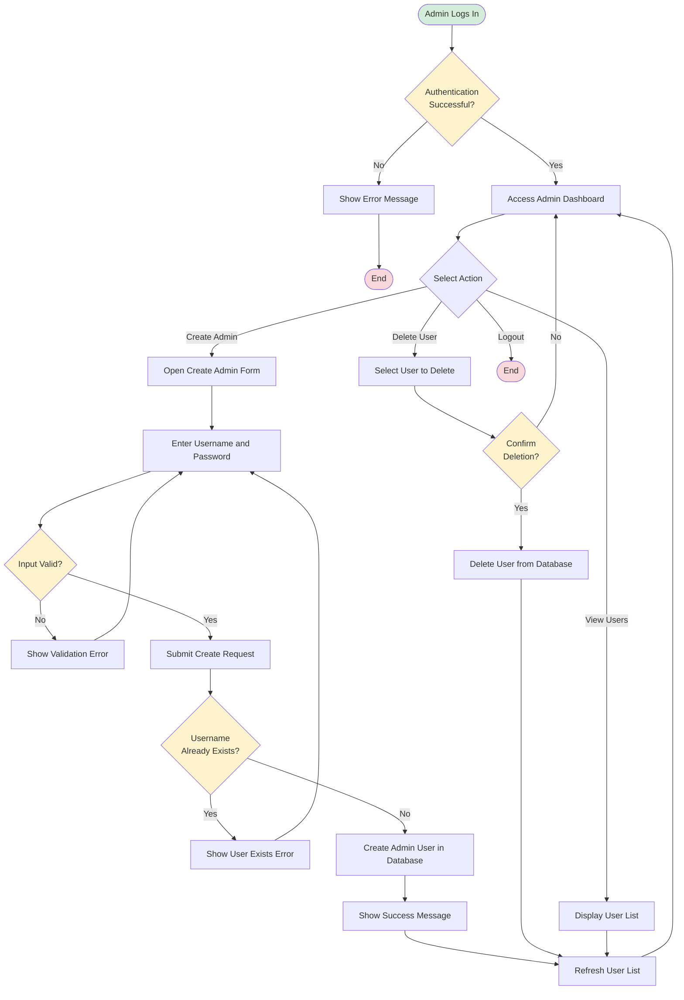
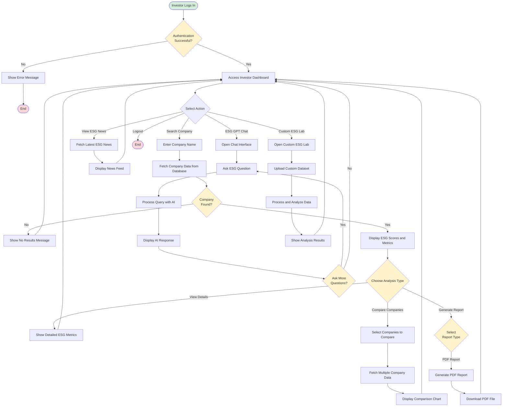
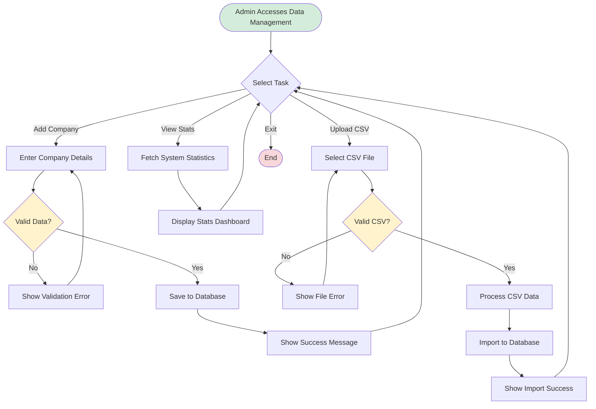
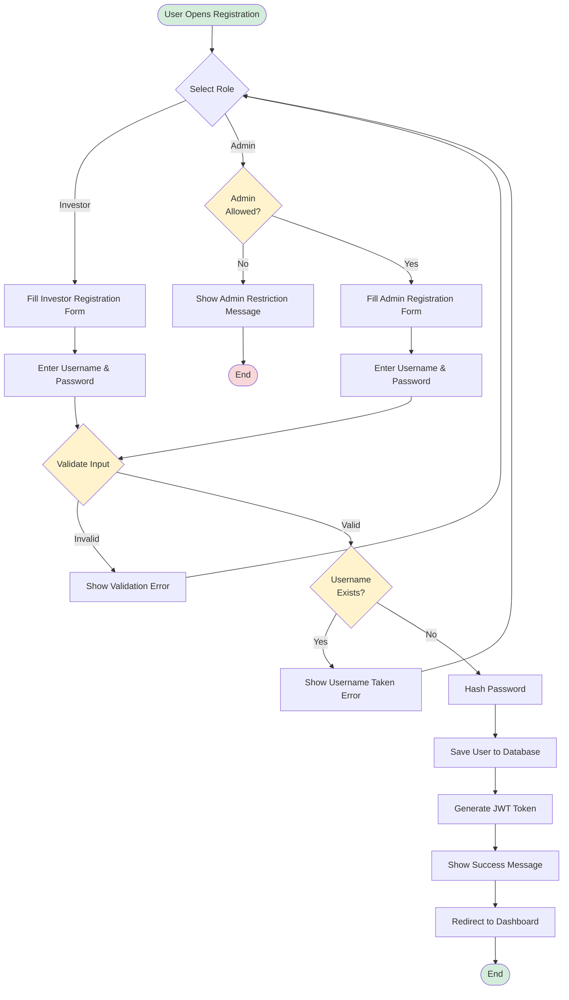

# Activity Diagrams - ESG Intelligence Platform

## 1. Admin User Management Activity Diagram

## 2. Investor ESG Analysis Activity Diagram

## 3. Admin Data Management Activity Diagram

## 4. User Registration Activity Diagram

## Summary

These activity diagrams show:

1. **Admin User Management** - Create, delete, and view users
2. **Investor ESG Analysis** - Search, analyze, chat, news, and custom lab workflows
3. **Admin Data Management** - Add companies, upload CSV, view stats
4. **User Registration** - Registration flow for both investors and admins

Each diagram includes:
- ✅ Decision points (diamonds)
- ✅ Process steps (rectangles)
- ✅ Start/End points (rounded)
- ✅ Error handling flows
- ✅ Success paths
- ✅ Color coding for clarity
